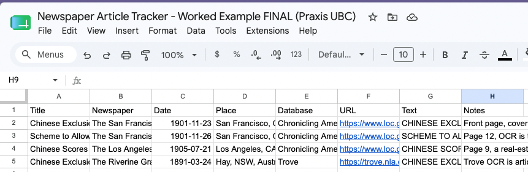

::: {.notes}
Welcome. Today is practical: by the end of the hour everyone should have found, downloaded and logged at least one historical newspaper article. Before we can analyze historical news, by close reading or with computational tools, we need to get our hands on the newspapers themselves.
:::

## By the end of today you can

1. Search each database and filter by date, place and newspaper
2. Open an article and read it as a scan of the original page
3. Download the article as a PDF and view its OCR text
4. Compare the page image to the raw text and spot OCR errors
5. Keep track of your articles in a simple spreadsheet

::: {.notes}
Five concrete skills. The last one, the spreadsheet, quietly turns you into someone building a dataset, which is where computational methods start.
:::

## A digitized newspaper is two things

:::: {.columns}
::: {.column width="50%"}
### The image

- A scan of the original page
- For human eyes
- Used for close reading
:::
::: {.column width="50%"}
### The OCR text

- Text a computer extracted from the image
- What makes the page searchable
- Contains errors
:::
::::

::: {.notes}
OCR stands for optical character recognition. When you search a database you are searching the OCR text, not the images. Keep asking: am I looking at the page, or at the computer's guess about the page?
:::

## Running example: Chinese immigration and exclusion, ca. 1880–1905

| Country | Year | Law |
|---|---|---|
| United States | 1882 | Chinese Exclusion Act |
| Canada | 1885 | Head tax, raised to \$100 (1900) and \$500 (1903) |
| Australia | 1901 | Immigration Restriction Act ("White Australia") |

**How did newspapers in each country talk about these events?**

::: {.notes}
This topic lets us compare all four databases: the US in Chronicling America, Australia in Trove, and Canada in both BC Historical Newspapers and Canadiana. You will follow the same steps with your own topic at the end.
:::

## Chronicling America: how it was built

- Part of the **National Digital Newspaper Program** (NEH + Library of Congress)
- Institutions in each state **apply for grants** to digitize their own papers
- The Library of Congress hosts the results; it does not choose them
- U.S. pages from 1770 to 1963, free, no copyright restrictions

**Consequence: coverage is uneven across states.**

::: {.notes}
Early, repeat grant winners like California have hundreds of thousands of pages; late joiners have far fewer. Within a state, coverage also reflects what each partner prioritized and what survived on microfilm. Where to check: the About page, the list of all digitized titles, and the list of NDNP awardees by state.
:::

## Beware raw hit counts

A hypothetical search for "Chinese exclusion":

- **4,000** hits from California
- **200** hits from Illinois

Hit counts measure the shape of the database at least as much as the shape of history.

**Safer:** compare coverage *within* specific, comparable newspapers.

::: {.notes}
Ask the room first: what would you conclude? Most people say California discussed the topic far more. Maybe, but far more California pages are in the database. The numbers are illustrative, not real results. Comparable means similar city size, run of dates and politics.
:::

## Chronicling America: searching

:::: {.columns}
::: {.column width="50%"}
### Filters

- Date: e.g. 1880–1905
- State: e.g. California
- Newspaper: follow one title
:::
::: {.column width="50%"}
### Search tips

- Quote phrases: `"Chinese exclusion act"`
- Use the papers' own vocabulary
- Fewer, distinctive words
:::
::::

::: {.notes}
Live demo: search Chinese exclusion and show the highlighted matches, then apply the date and state filters. Period newspapers used terms we would not use today, including slurs; "Celestials" and "coolie labor" find far more than "Chinese immigrants". Searching that vocabulary, however uncomfortable, is often necessary. Ask: what words would the newspapers themselves have used?
:::

## Chronicling America: reading and downloading

1. **Open** the page viewer: zoom, drag, flip pages
2. **Download PDF**: the page as an image, for close reading
3. **Image w/Text**: view the OCR; copy it to a `.txt` file or use OCR (ALTO)

Keep the pair together:

`1882-05-10_daily-alta.pdf` and `1882-05-10_daily-alta.txt`

::: {.notes}
Demo article: "Chinese Exclusion Convention Opens Fight in Defense of American Labor," The San Francisco Call, 22 November 1901, front page. Point out that the OCR text is what the search box actually searched.
:::

## Trove: how it was built

- **Australian Newspaper Digitisation Program**, with state and territory libraries
- Since 2010, outside groups can **pay to digitize** a title
- Usually only one edition per day
- About **1,800** of roughly **7,700** Australian newspapers are in Trove

::: {.notes}
Selection is based on significance, use, geography and whether good microfilm exists. Some titles are in Trove because a local group championed them, not because a curator judged them representative. Recommend Tim Sherratt's Trove Data Guide.
:::

## Trove: searching and downloading

1. **Search**: `Chinese immigration restriction`
2. **Filter**: decade, state, category = Article
3. **Read**: OCR text beside the scanned article
4. **Download**: both the PDF and the text

**Quirk:** users can correct the OCR, so popular articles often have cleaner text.

::: {.notes}
Filters are on the right side in Trove. The category filter excludes advertising and family notices. When comparing OCR quality across articles, clean text may just mean a volunteer fixed it.
:::

## The golden rule {background-color="#9a3324"}

[**Always find out how the database you're searching was created.**]{style="color:#ffffff;font-size:1.4em"}

[Otherwise you may mistake a gap in the archive for a silence in history.]{style="color:#ffffff"}

::: {.notes}
Every collection is the product of decisions about funding, selection, copyright and survival. Read the About page before you trust the search box.
:::

## BC Historical Newspapers: how it was built

- Began in 2010 as a UBC pilot project
- 168 titles and 55,000+ issues by 2021; 70,000+ issues by 2022–23
- Scanned from microfilm (Royal BC Museum / BC Archives)
- Copyright checked before titles are added; still growing

**Mostly interior towns.** The *British Colonist* is at britishcolonist.ca instead.

::: {.notes}
Community newspapers from across BC, 1859 to 1995. Most Chinese immigrants arrived through coastal ports, but much of this collection comes from interior towns. Check where each title was published before comparing coverage.
:::

## BC Historical Newspapers: an item page

Example: *The Prospector* (Lillooet), 27 July 1900. Search `"head tax" Chinese`, 1880–1905.

- A result is a **whole issue**
- Metadata: location, source, date available, rights
- Tools: Search Inside, Image Viewer, Download As PDF, Generate Citation
- Record the **Permanent URL (DOI)**, not the browser address

::: {.notes}
Rights: research and reference use only; permission to reuse must come from UBC's Digitization Centre. The matched passage is an editorial, "The Yellow Curse," reprinted from the New Denver Ledge, responding to the head tax rising from 50 to 100 dollars and arguing for 1,000. Read it for what it reveals about attitudes in an interior mining district, and quote deliberately. On faded pages OCR can be close to unreadable: browse by date and read the image.
:::

## Canadiana: how it was built

| Year | Event |
|---|---|
| 1978 | CIHM founded (microfilming project) |
| 2008 | Becomes Canadiana.org |
| 2018 | Merges with CRKN |
| 2019 | Paywall removed; now free |

Newspapers, books, periodicals and government publications in one search.

::: {.notes}
Some papers were digitized for other projects, for example UVic's microfilm of the Victoria Daily Times. Who paid for a scan, and why, shapes what is there. Access rules change, so always record the date you consulted a source.
:::

## Canadiana: searching

- **Date Range**: e.g. 1880–1901
- **Language**: search in Chinese characters to find Chinese-language papers
- **Collection**: tick Newspapers

**Watch out:** 822 results in our example have language *Undetermined*. Tick only English and they disappear.

::: {.notes}
Top results come from the Victoria Times and The Semi-Weekly Colonist, coastal papers missing from BC Historical Newspapers. Using the two databases together gives you both the interior towns and the coast.
:::

## Canadiana: where is the OCR text?

The text is searched, but never shown. To get it:

1. Download the page PDF
2. Select and copy its text
3. Paste into a plain text file
4. Find your article and clean it against the image

Formatting is lost, so treat "no results" with extra caution.

::: {.notes}
Demo item: The Semi-Weekly Colonist (Victoria), 19 March 1901. One newspaper can be spread across several databases. Pages without full-text search never turn up in keyword search. Follow the Citation Guide at the top of the site.
:::

## Four databases side by side

| | Chronicling America | Trove | BC Historical | Canadiana |
|---|---|---|---|---|
| **Built through** | State grants | National program + paid | UBC projects | Microfilming project |
| **A result is a…** | Page | Article | Issue | Item |
| **OCR text** | Shown | Shown | Shown | Hidden |

::: {.notes}
Ask which difference would most change how they'd design a comparison, for example article-level versus page-level results when counting coverage.
:::

## Two questions for any collection

1. **How did it become available?**
   Who built it, who paid, how titles were chosen
2. **What did it make available?**
   Which years, places, languages and voices; what is missing

::: {.notes}
These generalize the golden rule and apply to archives we haven't covered today.
:::

## Comparing the image to the text

Common OCR errors:

- Confused letters: *e* → *c*, *rn* → *m*, *ſ* → *f*
- Broken words where the scan is faded or torn
- Text from neighbouring columns jumbled together
- Missing passages where the page is damaged

::: {.notes}
Open the PDF and text side by side and read a paragraph in each. Invite people to call out the worst error they can spot.
:::

## Why this matters

- **Search is imperfect:** no results ≠ no articles
- **Counts are noisy:** word counts inherit OCR mistakes
- **Reading still matters:** the scan is the ground truth

::: {.notes}
Word counts, topic models, sentiment analysis, machine learning, large language models: all start from this text. OCR quality is an active research area, and AI-based methods can dramatically improve it. We'll touch on this in the seminar.
:::

## Keeping track: one row per article

Paste the full OCR into **Text** and your finding aid becomes a **dataset**.

::: {.notes}
Start from our template spreadsheet (link in the walkthrough), then File, Make a copy. Trove text is already one article; Chronicling America, BC Historical Newspapers and Canadiana give whole pages, so trim out the neighbouring articles and ads. In our example we cut a patent-medicine ad and a murder inquest out of one article's text. Every form of text analysis starts from exactly this structure.
:::

## Three habits from day one

- **Dates as YYYY-MM-DD** (e.g. 1882-05-10): they sort correctly
- **Always record the URL** and the database; use a permanent link where offered
- **Use the Notes column**: page, OCR quality, what you trimmed, what struck you

::: {.notes}
Six months from now the URL is how you, or a reader of your work, get back to the source. Notes like these are the seed of qualitative coding.
:::

## Now you try (10 minutes)

Pick a topic that crossed borders, e.g. the gold rushes (California 1849; Victoria and NSW 1851; Fraser River 1858).

1. Search Chronicling America; refine your terms
2. Filter by date and place
3. Save one article's PDF and OCR text
4. Repeat in Trove, BC Historical Newspapers or Canadiana
5. Note the worst OCR error you find
6. Enter your articles in the template spreadsheet

::: {.notes}
Other prompts: a person, ship, disaster or scandal reported internationally, or a theme from your own research. Circulate during this block. Common sticking points: search terms that are too modern, and forgetting to record the URL.
:::

## A note on difficult material

Historical newspapers contain racist language and viewpoints, especially on immigration and exclusion.

Encountering this material is part of doing this history; reproducing its framing is not. **Quote deliberately and provide context.**

::: {.notes}
Revisit "The Yellow Curse" editorial as an example: we read it for what it reveals about attitudes, not to repeat its argument. This applies to search terms too.
:::

## Questions?

- [Chronicling America](https://www.loc.gov/collections/chronicling-america/)
- [Trove](https://trove.nla.gov.au/newspaper/)
- [BC Historical Newspapers](https://open.library.ubc.ca/collections/bcnewspapers)
- [Canadiana](https://www.canadiana.ca/)
- [British Colonist](https://britishcolonist.ca/) · [Trove Data Guide](https://tdg.glam-workbench.net/)

::: {.notes}
Close by repeating the golden rule: find out how a database was built before you trust its search box.
:::
