# Introduction

Before we can analyze historical news, whether by reading closely or by using computational tools, we need to get our hands on the newspapers themselves. This walkthrough shows you how to do that using four free, public databases of digitized historical newspapers:

- **[Chronicling America](https://www.loc.gov/collections/chronicling-america/about-this-collection/)** (Library of Congress) — millions of digitized U.S. newspaper pages from 1770 to 1963, with no copyright restrictions.
- **[Trove](https://trove.nla.gov.au/)** (National Library of Australia) — Australia's equivalent collection, with digitized newspapers going back to 1803.
- **[BC Historical Newspapers](https://open.library.ubc.ca/collections/bcnewspapers)** (UBC Library) — digitized community newspapers from across British Columbia, dating from 1859 to 1995.
- **[Canadiana](https://www.canadiana.ca/)** (Canadian Research Knowledge Network) — Canadian newspapers alongside books, periodicals and government publications, all in one search.

All four databases work like an ordinary website: you type a search, click on results, and download articles.

A digitized newspaper is really two things: an **image** of the original page, and **computer-generated text (OCR)** extracted from it. The image is for human eyes; the text is what makes it readable and searchable by computers.

::: {.callout-note}
## Our running example

Throughout this guide we search for coverage of Chinese immigration and exclusion, ca. 1880–1905. This topic is a natural comparison across the databases: the United States passed the Chinese Exclusion Act in 1882, Canada imposed a head tax on Chinese immigrants in 1885 (raised to \$100 in 1900 and \$500 in 1903), and Australia passed the Immigration Restriction Act (the "White Australia" policy) in 1901. How did newspapers in each country talk about these events? You'll follow the same steps with your own topic afterward.
:::

## Learning objectives

1. Search each database and filter results by date, place, and newspaper.
2. Open an article and read it as a scan of the original page.
3. Download the article as a PDF and view its OCR text.
4. Compare the page image to the raw text, and spot OCR errors.
5. Keep track of the articles you collect in a simple spreadsheet.

# Chronicling America (United States)

Chronicling America is maintained by the Library of Congress. Everything in it is free to use, with no copyright restrictions. You can find it at the [Chronicling America collection page](https://www.loc.gov/collections/chronicling-america/).

## Searching for a topic

1. Go to the [Chronicling America collection page](https://www.loc.gov/collections/chronicling-america/).
2. Find the search box near the top of the page.
3. Type your search terms. For our example, try: `Chinese exclusion`
4. Press Enter or click the search button.

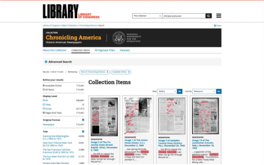

You should see a list of results — each one a newspaper page where your search terms appear. The matched words are usually highlighted on the page image.

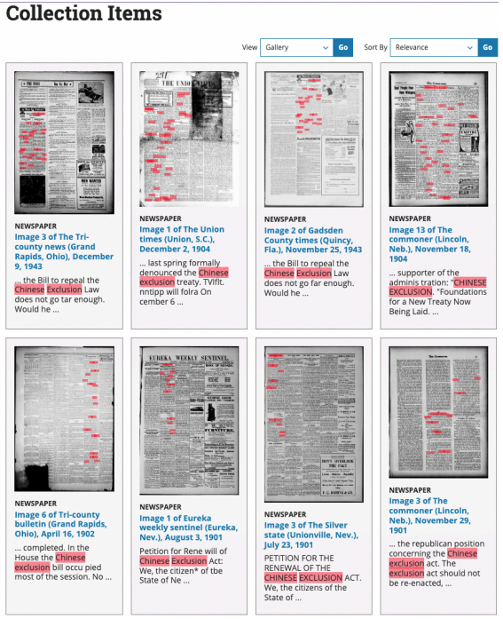

## How the collection was built

Before searching any database, it's worth asking a deceptively simple question: *how did this material get here?*

Chronicling America is the public face of the **National Digital Newspaper Program (NDNP)**, a partnership between the National Endowment for the Humanities and the Library of Congress. Under the NDNP, institutions in each state (university libraries, state archives, historical societies) apply for grants to select and digitize newspapers from their own state. The Library of Congress hosts the results; it does not choose them.

This has an important consequence: ***coverage is uneven***. States that joined the program early and won repeated grants (like California) are represented by hundreds of thousands of pages, while states that joined late contribute far less. Within a state, coverage also reflects what each partner chose to prioritize and what survived on microfilm in the first place.

Why does this matter for your research? Suppose you search "Chinese exclusion" and get 4,000 hits from California but only 200 from Illinois. It is tempting to conclude the topic was discussed far more in California. But the difference may simply be that far more California pages are in the database. Raw hit counts across states (or across time) measure the shape of the database at least as much as the shape of history.

If you want to compare places or periods, the safer strategy is to pick specific newspapers you know are comparable — similar city size, similar run of dates, similar politics. Then compare coverage *within* those titles.

You can check what's actually in the database:

- Read [about the collection](https://www.loc.gov/collections/chronicling-america/about-this-collection/) at the Library of Congress.
- Browse [all digitized titles](https://www.loc.gov/collections/chronicling-america/?fa=partof:chronicling+america) to see how many papers, and which years, your state actually has.
- See the [list of NDNP awardees by state](https://www.loc.gov/ndnp/listawardees.html).

## Narrowing your results

A broad search can return tens of thousands of pages. Use the filters (usually on the left side of the results page) to narrow things down:

- **Date**: restrict to a range, e.g. 1880 to 1905.
- **Location / State**: e.g., California, where coverage of Chinese exclusion was especially heavy.
- **Newspaper**: limit to a single title if you want to follow one paper's coverage over time.

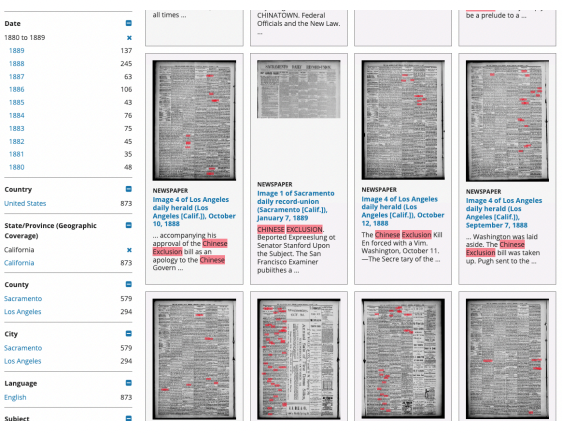

::: {.callout-tip}
## Search tips

- Put phrases in quotation marks to search them as a unit: `"Chinese exclusion act"`.
- Historical vocabulary matters. Newspapers of the era used terms we would not use today; searching period vocabulary (however uncomfortable) is often necessary to find period coverage. Think about what words *the newspapers themselves* would have used.
- For example, a search for "Chinese immigrants" finds far less than the terms the papers actually used: "Chinamen," "Celestials," "coolie labor."
- Fewer, more distinctive words usually beat long queries.
:::

## Opening and reading an article

Click on any result to open the **page viewer**. You are now looking at a scan of the actual newspaper page. You can:

- Zoom in and out with the controls (or your scroll wheel).
- Drag the page around to move between columns.
- Use the arrows to flip to the previous/next page of that issue.

## Downloading the PDF

On the page viewer, look for the download options (often labeled "Download" or shown as icons near the image). Choose PDF.

For our example, we'll use ["Chinese Exclusion Convention Opens Fight in Defense of American Labor," The San Francisco Call, November 22, 1901, front page](https://www.loc.gov/resource/sn85066387/1901-11-22/ed-1/?sp=1&q=chinese+exclusion).

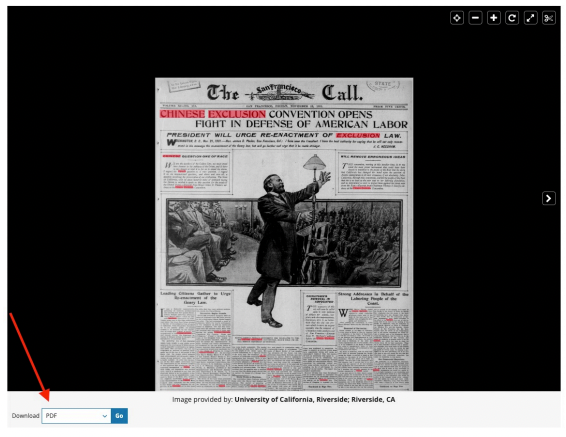

The PDF saves to your computer like any other download. Open it — it's simply the newspaper page as an image you can read, print, or file away. This is the version you'd use for **close reading**.

## Viewing the OCR text

Now for the interesting part. On the same page viewer, look for an option labeled "Image w/Text" (sometimes "OCR" or "Full text"). Click it.

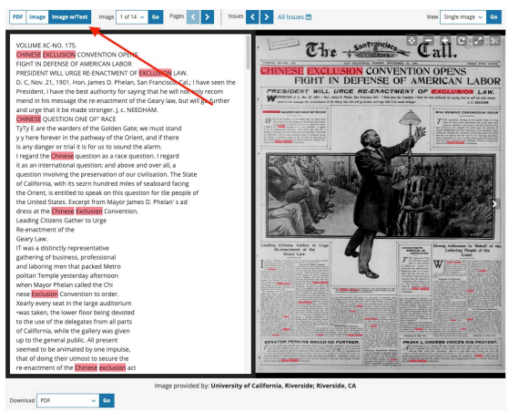

What you're seeing is the computer's attempt to *read* the page image and turn it into typed text. This text is what makes the page searchable. When you searched "Chinese exclusion," the database was searching this OCR text, not the images.

You can save this text: select all of it (Ctrl+A / Cmd+A), copy, and paste into a plain text file (using Notepad on Windows or TextEdit on a Mac), or use the text download option `OCR(ALTO)`. Save it with the same name as your PDF so the pair stays together, e.g. `1882-05-10_daily-alta.pdf` and `1882-05-10_daily-alta.txt`.

# Trove (Australia)

Trove is run by the National Library of Australia and works on the same principle: scanned newspaper pages plus searchable OCR text, all through a normal website. You can find it at the [Trove newspapers page](https://trove.nla.gov.au/newspaper/).

## Searching for a topic

1. Go to the [Trove newspapers page](https://trove.nla.gov.au/newspaper/).
2. Type your search into the search box. For our example: `Chinese immigration restriction`
3. Press Enter.

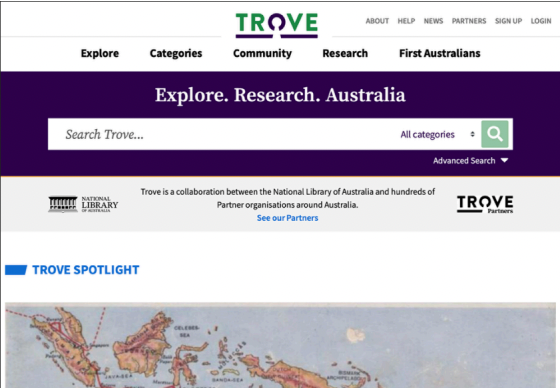

## How the collection was built

Trove's digitized newspapers come from the **Australian Newspaper Digitisation Program (ANDP)**, coordinated by the National Library of Australia together with the state and territory libraries. Titles are selected based on historical significance, how heavily they're used, geographic coverage, and whether a good microfilm copy exists to scan from.

There is a second route into Trove that Chronicling America doesn't have: since 2010, outside contributors (local councils, historical societies, public libraries, even individuals) can nominate a newspaper and *pay for* its digitization. Hundreds of organizations have done so. This is wonderful for access, but it means some titles are in Trove because a local group championed them, not because a curator judged them representative.

The scale of what's missing is worth sitting with: roughly 7,700 newspapers have been published in Australia, but only about 1,800 titles are in Trove. Which ~1,800? The ones that funding, microfilm availability, and local enthusiasm favored. Even digitized titles may have gaps — Trove usually includes only one edition per day, even for papers that printed several.

Where to check:

- Read about [Trove's digitised newspapers](https://trove.nla.gov.au/landing/newspapers).
- Browse the [full list of digitised titles](https://trove.nla.gov.au/newspaper/about), including forthcoming titles.
- Explore the [Trove Data Guide](https://tdg.glam-workbench.net/) — an excellent, honest look under the hood.

::: {.callout-important}
## The golden rule of database research

***Always find out how the database you're searching was created.*** Every digital collection is the product of decisions (funding, selection, copyright, survival) made long before you typed your search. If you don't know those decisions, you can draw conclusions that are exactly backwards: mistaking a gap in the archive for a silence in history. Look for the "About" page before you trust the search box.
:::

## Narrowing your results

Use the filters (on the right side) to refine:

- **Decade / year**: e.g., 1890s–1900s for the lead-up to the Immigration Restriction Act.
- **State**: e.g., Victoria or New South Wales.
- **Category**: you can restrict to "Article" and exclude advertising and family notices.

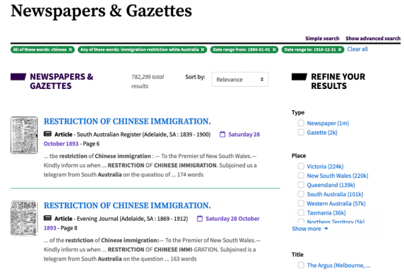

## Opening and reading an article

Click a result to open the article view. Trove shows you a **split screen**: the OCR text on the left, and the scanned image of the article on the right (the exact layout can vary). You can zoom the image and click through to see the full page the article came from.

::: {.callout-note}
## A Trove quirk worth knowing

Trove lets registered users *correct* the OCR text, and many volunteers do. This means some popular articles have unusually clean text (because a human fixed it) while obscure ones remain garbled. Keep this in mind when comparing OCR quality across articles.
:::

## Downloading the PDF and the text

Look for the Download button on the article view. Trove lets you choose what to download:

- **PDF** — the article (or the full page) as an image.
- **Text** — the OCR text as a plain text file.

Download both for your chosen article.

# BC Historical Newspapers (British Columbia)

BC Historical Newspapers is run by UBC Library and hosted on its Open Collections site. It is free to search and read, and it is the closest of our four databases to home: most of its titles are community newspapers from towns across British Columbia. You can find it at the [BC Historical Newspapers collection page](https://open.library.ubc.ca/collections/bcnewspapers).

## Searching for a topic

1. Go to the [BC Historical Newspapers collection page](https://open.library.ubc.ca/collections/bcnewspapers).
2. Type your search into the box labelled "Search for items in this collection". For our example, try: `"head tax" Chinese`
3. Use the **From** and **To** boxes beside it to limit the dates, e.g. 1880 to 1905.
4. Press Enter or click the search button.

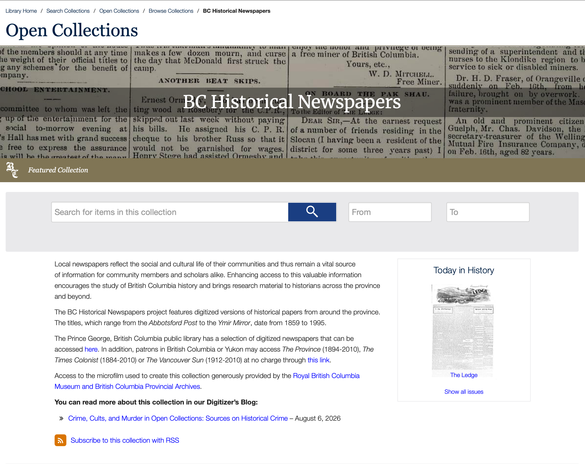

## How the collection was built

BC Historical Newspapers began in **2010 as the Early BC Newspapers Digitization Pilot Project** and has grown in phases since. By 2021 it held **168 titles and more than 55,000 issues**, and by 2022–23 the Digitization Centre reported more than 70,000 issues. Three facts about how it was made shape what you will find in it:

- **Microfilm came first.** The collection was scanned from microfilm provided by the Royal BC Museum and BC Archives. 
- **Copyright sets the boundary.** Titles are checked for copyright before they are added.
- **It is still growing.** In 2021, a co-op student working with BC Archives identified more than 150 further titles that could be added in future phases. Today's collection is a snapshot, not a complete record. If a small-town paper isn't here, that may only mean nobody has scanned it yet.

This matters for our running example. Most Chinese immigrants to Canada arrived through coastal ports, but much of this collection comes from interior towns. Before you compare coverage, check where each title was published.

::: {.callout-note}
## Where is Victoria's big daily?

BC's leading paper in the 1880s, the ***British Colonist***, is not in UBC's collection. Its full run (1858–1980) lives at [britishcolonist.ca](https://britishcolonist.ca/) (University of Victoria Libraries).
:::

## Opening an issue

Click a result to open the **item page** for that issue. In BC Historical Newspapers, a result is a whole issue, not a single article or page. For our example, we'll use *The Prospector* (Lillooet, B.C.), 27 July 1900.

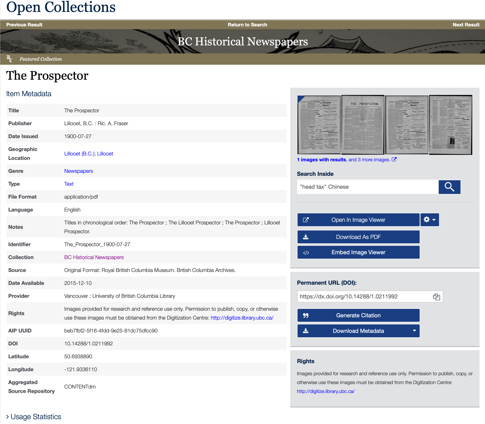

The left side of the item page is the issue's **metadata**, and it answers several of our "how did this get here?" questions directly:

- **Geographic Location**: Lillooet, an interior town, not a coastal port.
- **Source**: the original is held by the Royal BC Museum / BC Archives, which is where the microfilm came from.
- **Date Available**: when UBC put this issue online (here, 2015).
- **Rights**: images are provided for research and reference use only. Unlike Chronicling America, permission to publish or reuse them must be obtained from UBC's Digitization Centre.

The right side has the tools you'll use:

- **Search Inside**: search within this issue. Here it reports one page with results.
- **Open In Image Viewer**: read the pages and their OCR text (see below).
- **Download As PDF**: save the issue as a PDF for close reading.
- **Permanent URL (DOI)**: a stable link to this issue. Record this in the URL column of your spreadsheet rather than the address in your browser bar.
- **Generate Citation**: a ready-made citation for your notes or bibliography.

## Reading the page and its OCR text

Click **Open In Image Viewer**. Like Trove, the viewer shows the OCR text on the left and the page image on the right, with the issue's pages as thumbnails across the top.

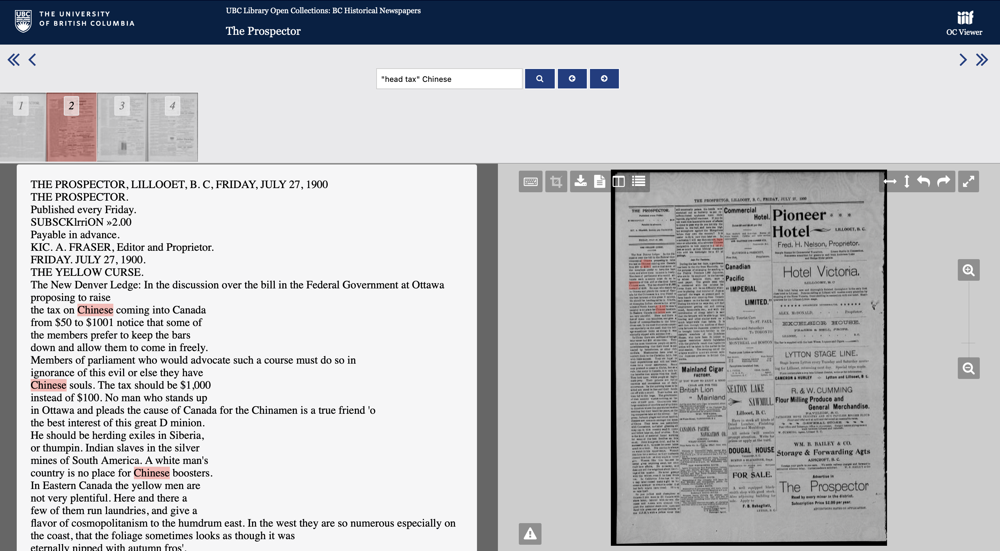

On this page the matched passage is an editorial titled "The Yellow Curse," reprinted from the *New Denver Ledge*. It responds to the federal bill raising the head tax on Chinese immigrants from \$50 to \$100, and argues that the tax should be \$1,000. This is the kind of material the note on difficult material (@sec-tryit) warns about: read it for what it reveals about attitudes in an interior mining district, and quote it deliberately.

The OCR on this page is fairly clean, but don't expect that everywhere in the collection. On faded or damaged pages, the OCR can be close to unreadable, with whole columns run together. When that happens, keyword search will miss articles that are really there, so browse issues by date and read the page image directly.

# Canadiana (Canada)

Canadiana is run by the **Canadian Research Knowledge Network (CRKN)**, a partnership of Canadian universities, and it is free to use. It has **not only newspapers**, but books, periodicals, annuals and government publications all come up in the same search. You can find it at [canadiana.ca](https://www.canadiana.ca/).

## Searching for a topic

1. Go to [canadiana.ca](https://www.canadiana.ca/).
2. Type your search into the search box. For our example, try: `Chinese immigration`
3. Press Enter.
4. Use the panel on the left ("Refine your search") to narrow the results.

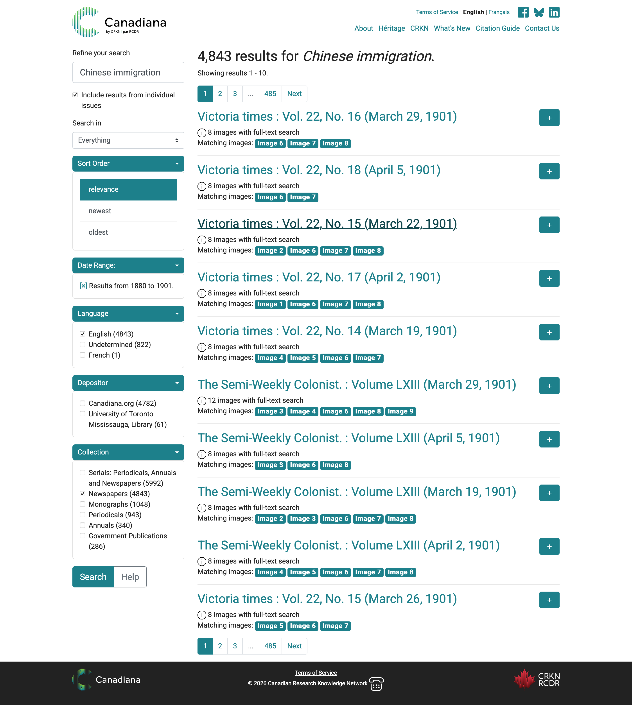

Each result is one item, usually a single newspaper issue. Under each title, Canadiana tells you how many of its pages ("images") have full-text search, and which ones matched your terms. Click a **Matching images** button (e.g. *Image 6*) to jump straight to that page.

Notice where the top results come from: the *Victoria Times* and *The Semi-Weekly Colonist*, both published in Victoria, the coastal city most Chinese immigrants passed through. These are exactly the kind of city papers that are missing from BC Historical Newspapers. Using the two databases together gives you both the interior towns and the coast.

## Narrowing your results

The "Refine your search" panel has more filters than the other databases. The ones that matter most:

- **Date Range**: e.g. 1880 to 1901.
- **Language**: **choose material by the language it was published in.** Canadiana is a bilingual (English and French) site, and it also holds material in other languages, including Chinese-language newspapers. The Language filter only lists the languages present in your current results, so a search in English words will mostly return English items. To find Chinese-language material, search in Chinese characters and then use this filter.
- **Collection**: the type of document. Tick **Newspapers** to exclude books, periodicals, annuals and government publications.

::: {.callout-tip}
## Watch the "Undetermined" language box

In our example, 822 results have their language recorded as *Undetermined*. If you tick only *English*, you silently drop every item whose language nobody recorded. A filter can only find what the metadata says, and metadata has gaps too.
:::

## How the collection was built

- **It began as a microfilming project.** Canadiana.org grew out of the Canadian Institute for Historical Microreproductions (CIHM), founded in 1978, which merged with AlouetteCanada in 2008 to form Canadiana.org. Much of what you see was scanned from microfiche and microfilm, including microfilm held by Library and Archives Canada.
- **It changed hands.** Canadiana.org merged with CRKN on 1 April 2018.
- **It used to cost money.** CRKN removed the subscription paywall on **1 January 2019**, so everything in the collections is now free to use. Access rules change, so always record the date you consulted a source.
- **Some newspapers were digitized for other projects.** The University of Victoria, for example, sent its microfilm of the *Victoria Daily Times* to Canadiana to be digitized, and Canadiana digitized the 1959–1980 run of the *Colonist* for britishcolonist.ca. Who paid for a scan, and why, shapes what is here.

## Opening, reading and downloading an item

Click a result to open the item viewer. The example here is *The Semi-Weekly Colonist* (Victoria), 19 March 1901, one of the results from our search. It is a weekly edition of the *British Colonist*, and it sits on Canadiana rather than on britishcolonist.ca: one newspaper can be spread across several databases.

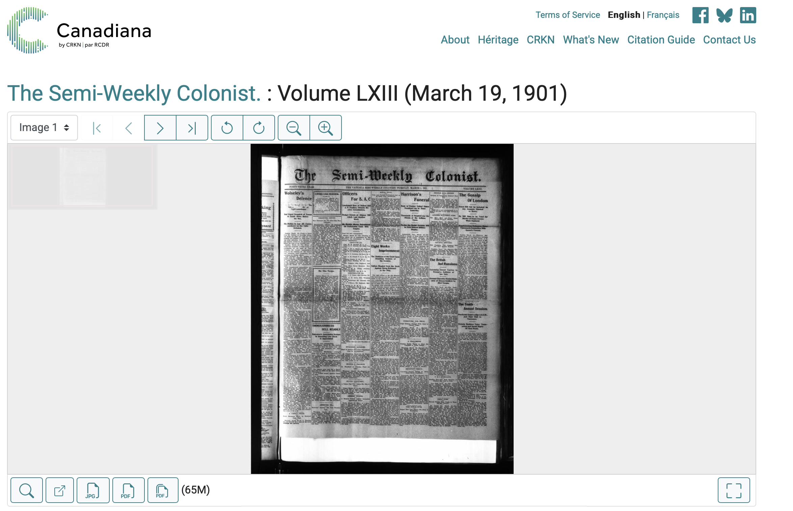

Along the top, the toolbar lets you move between pages and rotate or zoom the image. The toolbar along the **bottom** holds the tools you'll use most.

Below the viewer, the item record shows how many images the item has and how many of them have full-text search. Pages without full-text search will never turn up in a keyword search.

Record the item's URL and the date you consulted it. For anything you plan to cite, follow the **Citation Guide** linked at the top of the site.

::: {.callout-important}
## Where is the OCR text?

Unlike Chronicling America, Trove and BC Historical Newspapers, **Canadiana does not show you its OCR text.** The text is there, and it is what you are searching when you type in the search box, but the viewer only shows the page image.

To get the text, download the page PDF, open it, select the text, copy it, and paste it into a plain text file. The words come through, but **the formatting does not**: columns, headlines and line breaks are lost, and text from neighbouring columns can run together. You will need to find your article in the pasted text and clean it up, checking it against the page image.

Because you can't see the OCR in the viewer, you also can't easily judge its quality before you trust a search. Treat "no results" with extra caution here, and browse issues by date when it matters.
:::

# Four databases side by side

| | Chronicling America | Trove | BC Historical Newspapers | Canadiana |
|---|---|---|---|---|
| **Built through** | State grants | National program + paid contributions | Phased UBC projects | Microfilming project, now a university partnership |
| **Main limit** | U.S. copyright (to 1963) | Funding, microfilm | Copyright, microfilm; few big dailies | Varies; some rights held by others |
| **A result is a…** | Whole page | Single article | Whole issue | Item (usually an issue), with matching pages listed |
| **OCR text** | Shown beside the image | Shown beside the image | Shown beside the image | Hidden; copy from the PDF |

For any collection, the same two questions apply: **how did it become available** (who built it, who paid, how titles were chosen, what rules limited it), and **what did it make available** (which years, places and languages; whose voices; whole pages or single articles; what is missing)?

# Comparing the Image to the Text

You now have, for at least one article in each database:

1. a **PDF** — what the newspaper page actually looked like, and
2. a **text file** — what the computer *thinks* the page says.

Open them side by side and read a paragraph in each.

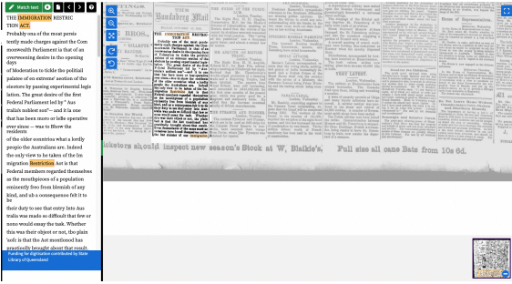

## What to look for

You will almost certainly find errors in the OCR text. Common ones in nineteenth-century newspapers:

- Confused letters: *e* read as *c*, *rn* read as *m*, the long *ſ* read as *f*.
- Broken words where the scan is smudged, faded, or torn.
- Column confusion: text from neighboring columns jumbled together.
- Missing passages where the page is damaged.

## Why this matters

This messy text is the raw material for *every* computational method you might hear about: word counts, topic models, sentiment analysis, machine learning, large language models. Three implications:

1. **Search is imperfect.** If the OCR misread a word, searching for that word will not find the page. Absence of search results is not evidence of absence.
2. **Counts are noisy.** Any method that counts words inherits the OCR's mistakes.
3. **Reading still matters.** The scan, the thing you close-read, remains the ground truth. Computational methods extend your reach across millions of pages; they don't replace checking the image.

The good news: OCR quality is an active research area, and modern AI-based methods can dramatically improve it.

# Keeping Track: A Simple Spreadsheet {#sec-tracker}

Once you're collecting more than a handful of articles, you need a system. A simple spreadsheet in Excel, Google Sheets, or Numbers is all it takes: **one row per article**, with columns for the headline, the newspaper, the date, the place, which database you found it in, the URL, the article's OCR text, and your notes.

Here is the tracker with three articles from *The San Francisco Call* and *The Los Angeles Herald* on Chinese exclusion:

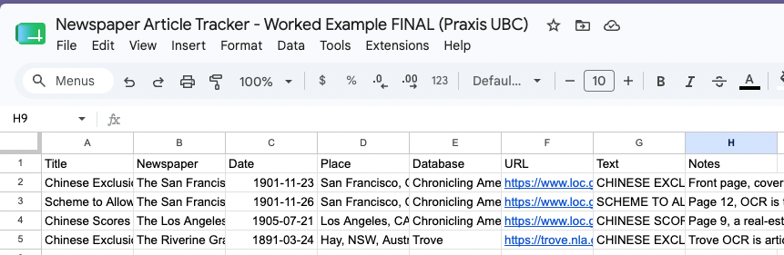

Rather than building this from scratch, start from our [template spreadsheet](https://docs.google.com/spreadsheets/d/1Rdv1zcft4v4u5o63JrNeAIA68BAFrxNKiT2FYr7h7ZU/edit?usp=sharing), which has all the columns set up along with our example articles. Open the link, then choose File → Make a copy to get your own editable version.

## The Text column

One column deserves special attention. Paste the article's full OCR text (the machine-readable text you saved earlier) directly into the Text cell for each row. It will look cramped, and that's fine.

The moment you do this, your spreadsheet stops being a mere finding aid and becomes a **dataset**: each row pairs an article's text with its metadata. Every form of text analysis you might do later (qualitative coding, word counts, sentiment analysis, machine learning) starts from *exactly* this structure. If you build this habit now, you are already doing computational social science. The computer just hasn't been asked to do anything yet.

One practical difference between our databases will show up here. *Trove* segments its pages into individual articles, so its downloaded text is already just the article. *Chronicling America's* OCR is *page-level*: the text file contains everything on the page (your article, its neighbors, and the advertisements) jumbled together. You'll need to find your article within it and trim away the rest before pasting. Look at the Notes column in our example: we had to cut a patent-medicine ad and a murder inquest out of one article's text. Expect the same trimming for *BC Historical Newspapers* and *Canadiana*, which give you whole pages; for Canadiana, the text copied from the PDF has also lost its formatting.

## Three habits worth adopting from day one

- **Write dates as YYYY-MM-DD** (e.g., 1882-05-10). They sort correctly and are unambiguous.
- **Always record the URL** (and the database you found it in). Six months from now, this is how you (or a reader of your work) get back to the source. Where a database offers a permanent link or DOI, use that.
- **Use the Notes column.** Record the page number, the OCR quality, what you had to trim, what kind of item it is (newspaper, report, book), and anything that struck you. Notes like these are the seed of qualitative coding.

# Now You Try {#sec-tryit}

Pick a topic of your own, ideally one that appears in more than one country's press. Some prompts:

- A comparative event: the gold rushes (California 1849; Victoria and NSW 1851; Fraser River, BC, 1858).
- A person, ship, disaster, or scandal reported internationally.
- A theme from your own research interests, tested in the period these databases cover.

Then work through the checklist:

1. Search your topic in Chronicling America. Adjust your search terms until the results look relevant.
2. Filter by date and place.
3. Choose one article. Download the PDF and save the OCR text.
4. Repeat steps 1–3 in Trove, BC Historical Newspapers, or Canadiana.
5. Compare each PDF against its OCR text. Note the worst OCR error you can find.
6. Start a spreadsheet from the template and enter your articles, pasting the OCR text into the Text column.

::: {.callout-warning}
## A note on difficult material

Historical newspapers contain racist language and viewpoints, especially on topics like immigration and exclusion. Encountering this material is part of doing this history; reproducing its framing is not. Quote deliberately and provide context.
:::

# References

**Chronicling America**

- Library of Congress. [About Chronicling America](https://www.loc.gov/collections/chronicling-america/about-this-collection/).
- National Endowment for the Humanities. [National Digital Newspaper Program](https://www.neh.gov/divisions/preservation/national-digital-newspaper-program).

**Trove**

- National Library of Australia. [Trove digitised newspapers](https://trove.nla.gov.au/landing/newspapers).
- Sherratt, Tim. [Trove Data Guide](https://tdg.glam-workbench.net/).

**BC Historical Newspapers**

- UBC Library. [BC Historical Newspapers](https://open.library.ubc.ca/collections/bcnewspapers), collection page and "About" text.
- Moberg, Laura. ["Expanding the BC Historical Newspapers Collection: Reflections on my Co-op Work Term"](https://digitize.library.ubc.ca/?p=7817). UBC Library Digitizers' Blog, 30 September 2021.
- UBC Library Digitization Centre. ["BC Historical Newspapers Update – 2017"](https://digitize.library.ubc.ca/?p=4842). UBC Library Digitizers' Blog, 25 May 2017.
- UBC Library Digitization Centre. [*Digitization Centre Impact Report 2022–2023*](https://wiki.ubc.ca/images/7/72/2022-2023_Digitization_Centre_Impact_Report.pdf).
- University of Victoria Libraries. [About the British Colonist Project](https://britishcolonist.ca/about.php).
- Vancouver Island Regional Library. ["BC Historical Newspapers"](https://virl.bc.ca/?p=103743) (the ProQuest archive of BC dailies).

**Canadiana**

- Canadian Research Knowledge Network. [History of Canadiana](https://www.crkn-rcdr.ca/en/history-canadiana).
- Canadian Research Knowledge Network. ["Over 60 Million Pages of Digitized Canadian Documentary Heritage Soon to Be Available at No Charge"](https://www.crkn-rcdr.ca/en/over-60-million-pages-digitized-canadian-documentary-heritage-soon-be-available-no-charge).
- Canadian Research Knowledge Network. [Canadiana Infrastructure Updates](https://www.crkn-rcdr.ca/en/canadiana-infrastructure-updates).
- University Affairs. ["Over 60 million pages of digitized Canadian heritage documents now accessible"](https://universityaffairs.ca/news/over-60-million-pages-of-digitized-canadian-heritage-documents-now-accessible/).
