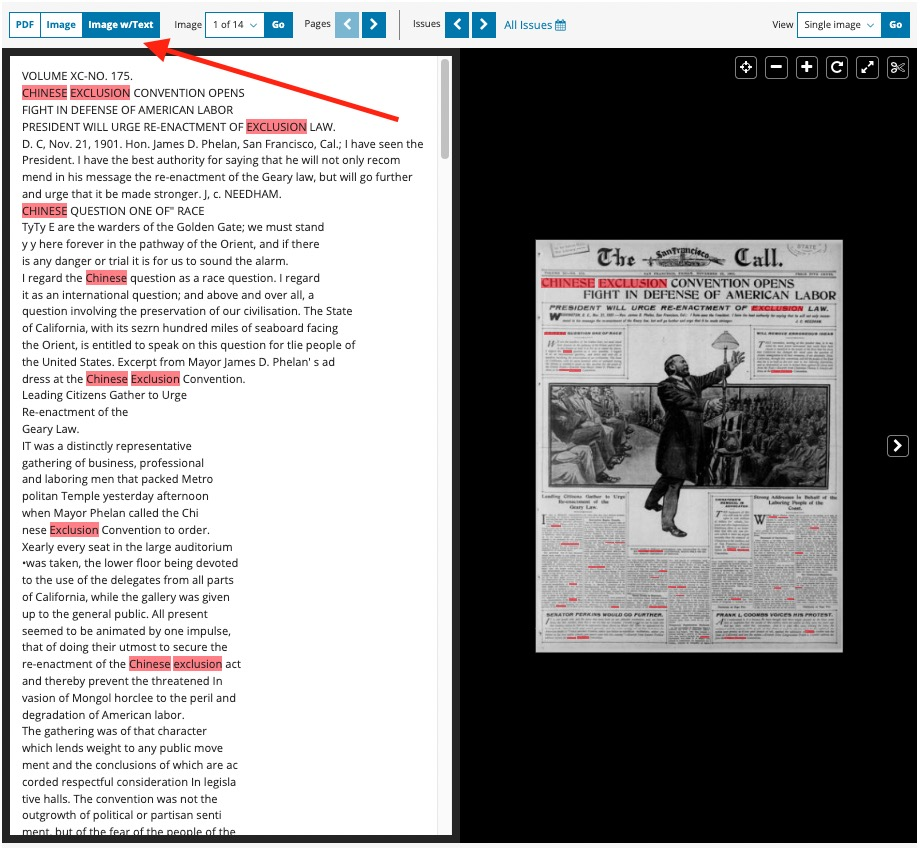
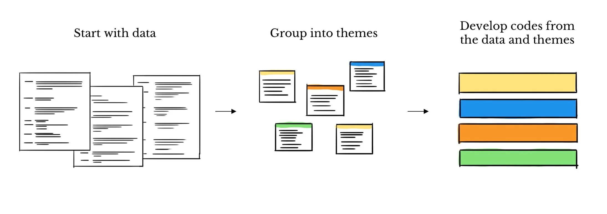
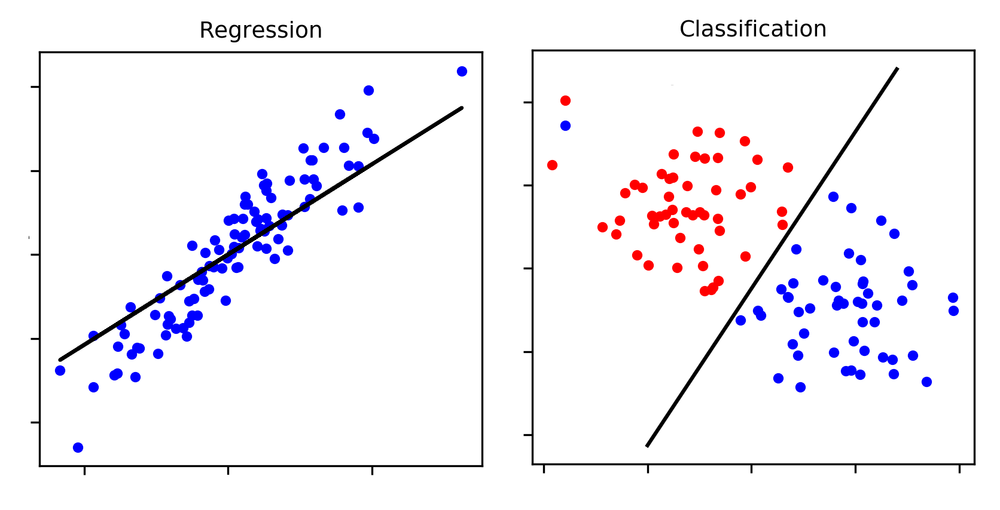
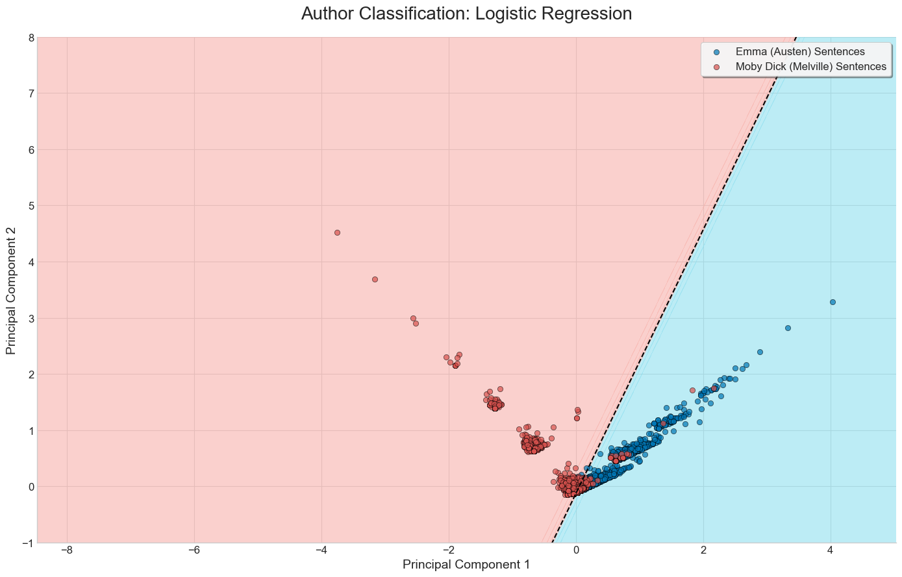
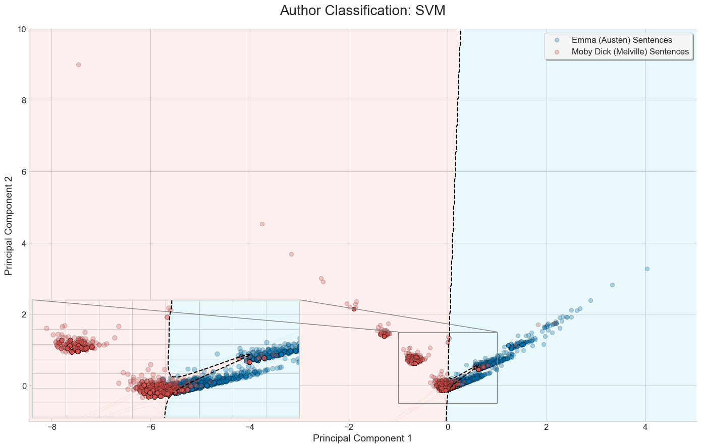
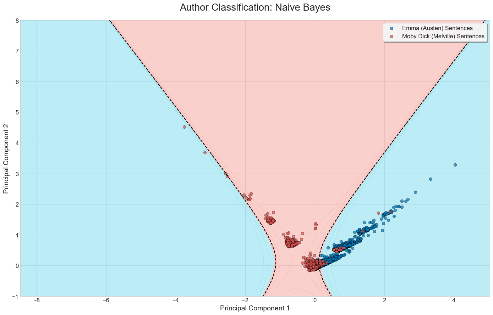
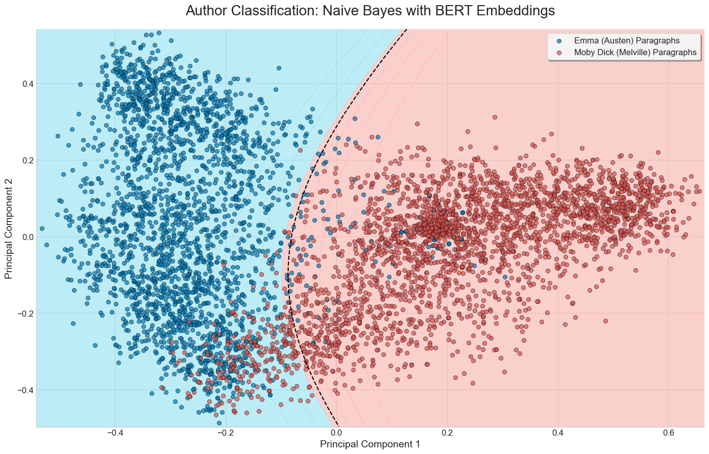
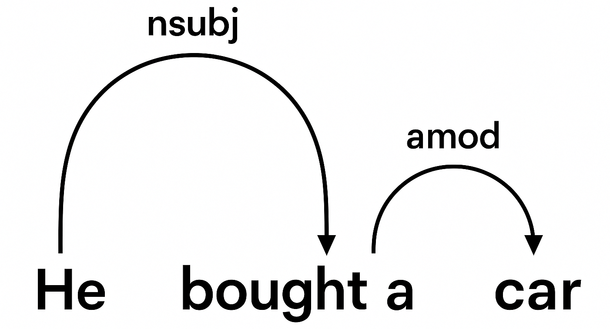
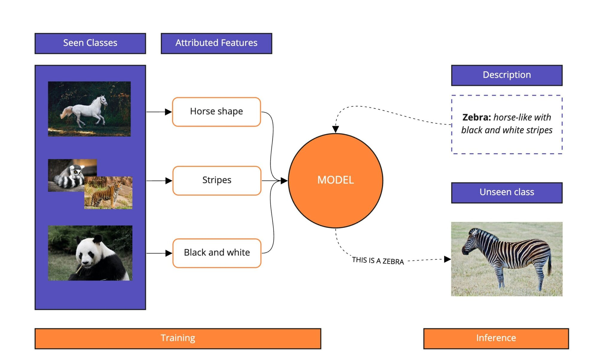

---
# Companion to text_analysis_simplified.qmd. The handout holds the detailed survey.
# 60-minute overview with section dividers, without speaker notes or an appendix.
# Use the arrow keys to advance and Esc for an overview.
pagetitle: "Text Analysis Overview: Slides"
format:
  revealjs:
    theme: simple
    width: 1280
    height: 720
    margin: 0.07
    center: false
    slide-level: 2
    slide-number: c/t
    transition: none
    navigation-mode: linear
    controls: true
    progress: true
    hash: true
    history: false
    overview: true
    auto-stretch: false
    scrollable: false
    smaller: false
    embed-resources: true
    html-math-method: mathml
    include-in-header:
      - text: |
          <style>
          :root { --ink: #142e40; --accent: #087c80; --muted: #52646f; }
          .reveal { font-family: Arial, Helvetica, sans-serif; font-size: 30px; color: var(--ink); }
          .reveal .slides { text-align: left; }
          .reveal h1, .reveal h2, .reveal h3 { font-family: Arial, Helvetica, sans-serif; color: var(--ink); text-transform: none; font-weight: 700; }
          .reveal h2 { font-size: 1.6em; line-height: 1.13; margin: 0 0 0.65em; }
          .reveal h3 { font-size: 1.08em; margin: 0 0 0.45em; }
          .reveal p, .reveal li { line-height: 1.32; }
          .reveal ul, .reveal ol { margin-left: 1.1em; }
          .reveal li { margin-bottom: 0.5em; }
          .reveal strong { color: var(--accent); }
          .reveal a { color: var(--accent); text-decoration: underline; text-underline-offset: 0.12em; }
          .reveal .columns { gap: 2em; align-items: center; }
          .reveal .top-align .columns { align-items: flex-start; }
          .reveal .column > :first-child { margin-top: 0; }
          .reveal img { margin: 0; max-width: 100%; object-fit: contain; }
          .reveal figure { margin: 0; }
          .reveal figcaption { color: var(--muted); font-size: 0.65em; text-align: left; margin-top: 0.5em; }
          .reveal table { width: 100%; font-size: 0.94em; border-collapse: collapse; margin: 0.6em 0; }
          .reveal th { color: var(--accent); font-weight: 700; border-bottom: 2px solid var(--accent); }
          .reveal th, .reveal td { text-align: left; padding: 0.48em 0.4em; border-bottom: 1px solid #cbd5db; vertical-align: top; line-height: 1.25; }
          .reveal .compact table { font-size: 0.86em; }
          .reveal .classifier-comparison table { table-layout: fixed; }
          .reveal .classifier-comparison th:first-child { width: 14%; }
          .reveal .classifier-comparison th, .reveal .classifier-comparison td { padding: 0.35em 0.4em; }
          .reveal .classifier-comparison td img { display: block; margin: 0 auto; }
          .reveal .framework-graphic { position: relative; width: 100%; max-width: 392px; aspect-ratio: 836 / 854; overflow: hidden; margin: 0.5em auto 0; }
          .reveal .framework-graphic img { position: absolute; top: 0; left: 0; width: 200%; height: 100%; max-width: none; max-height: none; }
          .reveal .framework-graphic.classification img { left: -100%; }
          .reveal pre { width: 100%; font-size: 0.7em; box-shadow: none; }
          .reveal pre code { padding: 0.7em; white-space: pre-wrap; overflow-wrap: anywhere; }
          .reveal blockquote { width: auto; margin: 0.7em 0; padding: 0.3em 0 0.3em 0.7em; border-left: 5px solid var(--accent); box-shadow: none; font-style: normal; }
          .reveal .citation { font-size: 0.65em; color: var(--muted); margin-top: 1.1em; }
          .reveal .caption { font-size: 0.72em; color: var(--muted); }
          .reveal .cover h2 { font-size: 2.7em; margin-top: 1.1em; margin-bottom: 0.35em; }
          .reveal .cover .subtitle { font-size: 1.35em; color: var(--accent); margin-bottom: 1.6em; }
          .reveal .cover .byline { font-size: 0.72em; color: var(--muted); line-height: 1.5; }
          .reveal .slides section.section-divider { text-align: left; }
          .reveal .slides section.section-divider h1, .reveal .slides section.section-divider .subtitle { font-size: 2.3em; line-height: 1.2; font-weight: 700; color: var(--ink); margin: 0; }
          .reveal .section-divider .subtitle p { margin: 0.15em 0 0; line-height: inherit; }
          .reveal .number-example { font-size: 1.8em; color: var(--accent); margin: 0.45em 0; font-weight: 700; }
          .reveal .slide-number { font-family: Arial, Helvetica, sans-serif; font-size: 16px; color: var(--muted); background: transparent; }
          .reveal .progress { color: var(--accent); }
          .reveal .controls { color: var(--accent); }
          </style>
execute:
  enabled: false
---


## Text Analysis {.cover}

::: {.subtitle}
An overview of manual coding and computational methods
:::

::: {.byline}
prAxIs UBC Team  
Irene Berezin, Alex Ronczewski, Krishaant Pathman, Fardin Kabir, Kamal Abou Mikhael
:::

## Text analysis: manual and computational methods

::: {.columns}
::: {.column width="60%"}
- In our previous lesson, we created a **corpus** through a search guided by our (preliminary) research question
- Pursuit of answers requires a systematic reading approach prescribed by your discipline (e.g., close reading, deep reading, hermeneutics)
- **Text analysis** in our lesson refers alternative methods: manual coding and computational methods
- These procedures focus on being rigorous, transparent, and documentable for the purpose of replicability
- They still require reading, but not of the same nature as traditional approaches

:::
::: {.column width="35%"}
{height="340px" fig-alt="Chronicling America displays OCR text alongside a newspaper page."}
:::
:::


::: {.citation}
Kuckartz & Rädiker (2023), Preface and §1.8
:::

# Section 1 {.section-divider .center}

::: {.subtitle}
Manual Coding
:::

## Manual coding: categories and judgment

A **code** labels a research-relevant feature. A **codebook** contains definitions of all categories. 

There are two of creating categories:

::: {.columns}
::: {.column width="51%"}
| Starting point | How categories develop |
|---|---|
| Deductive | Begin with a question or framework, then apply preset categories |
| Inductive | Read and compare passages to develop and refine categories |

Coding creates structured insights from the content of the corpus and analytical notes.

:::
::: {.column width="44%"}
{height="260px" fig-alt="Texts grouped into themes, followed by the development of categories."}
:::
:::

## A deductive codebook shapes the results

**Task:** code voter interviews using Economy, Healthcare, and Immigration.

::: {.compact}
| Comment | Code |
|---|---|
| “Groceries and gas are too expensive.” | Economy |
| “I want better access to doctors.” | Healthcare |
| “The government should secure the border.” | Immigration |
| “I don't trust politicians at all.” | No matching category |
:::

The final comment exposes a gap in the preset categories. Researchers must decide how to handle such passages.

## Shared coding requires instructions and checks {.top-align}

### Crowdsourcing

- Recruit participants to label passages through [CloudResearch Connect](https://www.cloudresearch.com/products/participant-recruitment/) or [Prolific](https://www.prolific.com/academic-researchers)
- Example: label 1,000 posts as positive, negative, or neutral
- Researchers define the categories, prepare participants, and check label quality

### Inter-coder reliability

- When multiple coders are involved, judgments may differ.
- Disagreements on how to label an article (e.g., *Workplace Inequality* versus *Identity & Respect*) can prompt clearer definitions and further interpretation.
- Statistical methods are used to measure degree of agreement between coders (inter-coder reliability)


# Section 2 {.section-divider .center}

::: {.subtitle}
Computational Text Analysis
:::

## Machine learning: approaches and workflow {.top-align}

**ML** learns patterns from examples to classify texts, predict values, or explore structure. Both supervised and unsupervised learning need a suitable numerical representation of text.

### Training

- **Supervised:** learn from labeled examples
- **Unsupervised:** find structure without predefined task labels

A parallel can be drawn between deductive/inductive coding approach and supervised/unsupervised learning.

- *Self-supervised learning*, often grouped under unsupervised learning, trains models using prediction tasks whose answers come from the text itself, such as predicting a hidden word.

::: {.callout-note title="Important term" icon=false}
**Neural network** is an ML model structure inspired by the human brain. It is organized into specialized layers, each consisting of a collection of individual processing units called **neurons** which are interconnected across layers.
:::

## 2.0 Text preprocessing {.top-align}

**Supervised and unsupervised models both need numerical representations of text.** The preprocessing steps depend on the model and research question.

### Typical decisions

1. **Tokenize** into words or word pieces
2. **Normalize** word forms when useful
3. Consider **stopword removal**
4. **Vectorize** the resulting text

We cover **vectorization in two stages**: counting and weighting methods (**BoW and TF-IDF**) here, and **learned representations** using unsupervised or self-supervised learning later.

::: {.caption}
Modern model pipelines can handle tokenization and numerical conversion automatically. Stopwords include common words such as “the” and “of”; removing them is optional.
:::

## Tokenization 

Tokenization is the process of reducing the document to a list of words and perhaps punctuation marks depending on the goal of the process.

### Example

“The pack of chihuahuas chased after the frightened cat.”

```text
['the', 'pack', 'of', 'chihuahua',
 '##s', 'chased', 'after', 'the',
 'frightened', 'cat', '.']
```

This tokenizer splits “chihuahuas” into “chihuahua” and “##s.”

## Normalization requires a research decision

| Technique | Operation |
|---|---|
| Stemming | Reduce words to a stem |
| Lemmatization | Reduce words to a dictionary form |

- These steps are optional
- They can merge words with different meanings
- They can also make topic outputs harder to interpret

::: {.citation}
The handout discusses these tradeoffs using Antoniak's (2022) practical guide.
:::

## Bag of words and TF-IDF represent text

**Vectorization** translates text into numerical features.

::: {.columns}
::: {.column width="48%"}
### Bag of words (BoW)

| Sentence | dog | cat | chased |
|---|---:|---:|---:|
| The dog chased the cat. | 1 | 1 | 1 |
| The cat chased the dog. | 1 | 1 | 1 |

Counts are easy to interpret. Large vocabularies create many zeros, and frequent terms can dominate.
:::
::: {.column width="47%"}
### TF-IDF

**Term frequency–inverse document frequency** weights a term using:

- Its frequency in one document
- Its rarity across the collection

“Whale” may help distinguish *Moby Dick* from other works.
:::
:::

Both representations omit word order, as the two sentences illustrate.

## 2.1 Supervised ML

### Workflow

1. **Train** on labeled texts
2. **Test** predictions on held-out examples
3. **Apply** to new texts after evaluation

## Statistical frameworks {.top-align}

::: {.columns}
::: {.column width="48%"}
### Regression

Predicts a **number**.\
Example: a case's year.

::: {.framework-graphic .regression}
{fig-alt="Regression plot showing blue data points around a fitted line."}
:::
:::
::: {.column width="48%"}
### Classification

Predicts a **category**.\
Example: an article's topic.

::: {.framework-graphic .classification}
{fig-alt="Classification plot showing red and blue groups separated by a decision boundary."}
:::
:::
:::

## Three classifiers, three decision boundaries

::: {.compact .classifier-comparison}
| Feature | Logistic regression | Support vector classification (SVC) | Naive Bayes |
|---|---|---|---|
| **Main idea** | Learn weights that predict class probabilities | Find a boundary with a wide margin | Estimate a class from word probabilities |
| **Strength / limitation** | Weights help explain assignments | Handles large vocabularies, sensitive to settings | Fast, assumes word independence given a class |
| **Decision boundary** | {height="180px" fig-alt="Logistic regression boundary for Emma and Moby Dick sentences."} | {height="180px" fig-alt="SVC boundary for Emma and Moby Dick sentences."} | {height="180px" fig-alt="Naive Bayes boundary for Emma and Moby Dick sentences."} |
:::

::: {.caption}
**SVC** is the classification form of support vector machines (**SVMs**). Each dot is a sentence from *Emma* or *Moby Dick*. The handout uses 20 frequent terms, excluding stopwords, and principal component analysis (PCA) to reduce counts to two dimensions. Assess prediction quality with held-out examples.
:::

## 2.2 Unsupervised learning {.top-align}

Discover patterns and structure **without predefined task labels**.

### Interrelated methods and representations

| Approach | What it does | What it produces |
|---|---|---|
| **Topic modelling** | Identifies recurring themes | Topic proportions for documents |
| **Clustering** | Groups similar texts | Group assignments or degrees of membership |
| **Word embeddings** | Learns numerical word representations | Vectors based on word usage |

Representations can provide inputs to clustering. Topic models can also produce **new document representations** for supervised or unsupervised tasks.

::: {.caption}
Word2Vec and BERT learn through **self-supervision**: prediction tasks whose answers come from the text itself.
:::

## 2.2.1 Topic modelling: themes depend on the corpus

**Topic modelling** identifies recurring themes. Researchers inspect words and passages to interpret and name the topics.

What topic would you assign to each pair of sentences?

**Topics are corpus-specific.** Their interpretation depends on the other texts in the collection.

::: {.compact}
| First pair | Second pair |
|---|---|
| **1.** French cuisine is some of the best in the world, despite the often lack of spices. | **1.** French cuisine is some of the best in the world, despite the often lack of spices. |
| **2.** I've always loved Japanese food, mainly because I prefer fish raw rather than cooked. | **2.** Dogs are very loud and unhygienic, yet people still love having them around. |
:::

## 2.2.2 Hard clustering: k-means and hierarchical

Clustering groups texts using **numerical representations**, such as TF-IDF vectors or document embeddings.

| Hard clustering method | How it works | Researcher decision |
|---|---|---|
| [k-means](https://scikit-learn.org/stable/modules/clustering.html#k-means) | Adjust group centers to bring similar texts together | Choose the number of groups, *k* |
| [Hierarchical](https://scikit-learn.org/stable/modules/clustering.html#hierarchical-clustering) | Merge or split groups to build a tree | Choose where to cut the tree |

Researchers choose the representation and settings, then interpret the groups. 

Hierarchical clustering can help explore relationships in smaller collections.

## 2.2.3/4 Soft clustering: LDA {.top-align}

**Latent Dirichlet Allocation (LDA)** learns topics and represents each document as a mixture of them.

::: {.columns}
::: {.column width="60%"}
- Number of topics set by researcher
- Identifies words that frequently appear together
- Assumes each document is a mixture of topics
- Matches words to topics and topics to documents
- Like BoW, not context-aware
:::
::: {.column width="40%"}
### Representing a document

Topic proportions:

| Topic | Proportion |
|---|---:|
| Economic policy | 0.6 |
| Climate change | 0.4 |

**Document-topic vector:** `[0.6, 0.4]`
:::
:::

LDA is also useful for reducing the size of document representation: proportions of topics instead of thousands of word counts.

## 2.2.5 Static Word Embeddings: Word2Vec

Word embeddings provide context-sensitive vectorization (vs. BoW and TF-IDF) by representing meaning based on surrounding words.

> “The film was incredible.”\
> “That movie is amazing.”

- Synonyms such as **film/movie** and **incredible/amazing** are close in the embedding space
- **Word2Vec** learns through self-supervised word-context prediction
- Each word has one static vector in a trained Word2Vec model (one fixed meaning)

::: {.caption}
Word vectors can be combined into representations of passages, then used for classification or clustering. Learning the vectors does not require clustering.
:::

## 2.2.6 Dynamic Word/Sentence Embeddings: BERT

::: {.columns}
::: {.column width="44%"}
**BERT:** Bidirectional Encoder Representations from Transformers

- A token's vector depends on its **context** and word order
- BERT weighs the relationship between a word and every other word in the sentence
- As opposed to BoW and TF-IDF, "The dog chased the cat" and "The cat chased the dog" have a distinct meaning in BERT
- BERT's embeddings can be used by supervised learning methods (Naive Bayes below)
:::
::: {.column width="51%"}
{height="350px" fig-alt="Two-dimensional visualization of Naive Bayes classification using BERT features for Emma and Moby Dick sentences."}
:::
:::

Pretrained BERT supplies representations; labelled examples train the **supervised classifier**. Passage representations can also be used for clustering.

## 2.3 NLP identifies entities and grammatical structure {.top-align}

**Natural language processing (NLP)** provides tools for analyzing and generating language.

::: {.columns}
::: {.column width="48%"}
### Relationships and structure

**Dependency analysis** links subjects, verbs, and objects. **Grammatical parsing** describes phrases and sentences.

{height="150px" fig-alt="Dependency diagram showing grammatical links in He bought a car."}

**Top-down parsing** starts with a sentence and works toward its grammatical parts. Structure supports translation and question answering.
:::
::: {.column width="47%"}
### Names and categories

**Named entity recognition (NER)** identifies a text span and assigns an entity category.

| Span | Category |
|---|---|
| University of British Columbia | Organization |
| Vancouver | Location |
| August 20 | Date |

Use the results to locate named items across a corpus.
:::
:::

## 2.4 Transformer families support different tasks

A **transformer** is the neural-network architecture behind BERT and many **large language models (LLMs)**.

**Encoding** = reader; **Decoder** = writer

| Family | Examples | Common uses |
|---|---|---|
| Encoder-only | BERT, RoBERTa | Embeddings, classification, NER |
| Decoder-only | GPT-style models, LLaMa | Chatbots, coding, summaries |
| Encoder–decoder | T5, BART | Translation, summarization, question answering |

## 2.4.1 Natural Language Inference (NLI) 

**Natural language inference (NLI)** compares a premise with a hypothesis and chooses three possibilities

**Premise:** “A man is riding a bicycle.”

| Hypothesis | Relation |
|---|---|
| A man is outdoors. | Entailment |
| A man is swimming. | Contradiction |
| The man is wearing a helmet. | Neutral |

Important because the model is making an **inference about meaning (reasoning)**.

## NLI and zero-shot classification

Zero-shot learning (ZSL) is a machine learning paradigm where a model classifies categories it has not been trained on. Rather it uses previous knowledge.

BERT's efficiency and depth of understanding make it the backbone of zero-shot and inference tasks.

Implications for text analysis: NLI-based zero-shot methods allows scaling of codebooks across large corpora, quick prototyping, and efficient processing of free-text.

## Zero-shot methods also connect images and text

::: {.columns}
::: {.column width="43%"}
- Vision-language systems combine images and text in the same "meaning space"
- This allows a model to classify **images it has never seen before** using natural-language descriptions
:::
::: {.column width="52%"}
{height="350px" fig-alt="Illustration of matching images with natural-language descriptions for zero-shot classification."}
:::
:::

::: {.citation}
Illustration from Modulai, “Zero-Shot Learning in NLP,” as used in the handout.
:::

## Four ways to guide an LLM

| Option | What the researcher supplies |
|---|---|
| Zero-shot prompting | Instructions and category definitions |
| Few-shot prompting | Instructions plus a few labeled examples |
| Retrieval-augmented generation (RAG) | Relevant passages retrieved for the request |
| Fine-tuning | Training examples that update model weights |

Instructions, examples, retrieval, and additional training provide different forms of guidance and can work together.

## Interface and hosting are separate choices {.top-align}

### How you interact

An **application programming interface (API)** connects software to the model.

| Interface | Useful for |
|---|---|
| Chat | Exploring passages and testing categories interactively |
| API | Repeating a task across a collection through code |

**Example:** test categories on a few parliamentary speeches in chat, then process thousands through an API with output checks.

## Interface and hosting are separate choices {.top-align}

### Where the model runs

| Hosting | Main considerations |
|---|---|
| Local | Control over data and environment, with hardware and setup requirements |
| Hosted service | Managed model access, with data handling terms and usage charges |

::: {.caption}
**UBC research:** follow institutional privacy, security, and ethics requirements before uploading research material. Consult [UBC Research Ethics](https://ethics.research.ubc.ca/) and applicable IT guidance. Either interface may connect to a local or hosted model.
:::

## API pricing varies by model

**USD per 1 million tokens, recorded November 3, 2026**

| Model | Input | Output |
|---|---:|---:|
| OpenAI GPT-6.1 Sol | $2.00 | $10.00 |
| OpenAI GPT-6 Luna | $0.10 | $0.50 |
| Anthropic Claude Opus 5.5 | $4.00 | $20.00 |
| Anthropic Claude Haiku 5.5 | $0.10 | $0.50 |

::: {.caption}
Handout rates for standard direct API use, uncached text input, and requests below 100,000 input tokens. Check current [OpenAI](https://developers.openai.com/api/docs/pricing) and [Anthropic](https://platform.claude.com/docs/en/about-claude/pricing) rates before budgeting.
:::

## Token usage determines the project budget {.top-align}

**10,000 newspaper passages**, each using **1,000 input tokens** and **500 billable output tokens**.

::: {.columns}
::: {.column width="47%"}
### One pass at the handout's rates

| Usage | Rate per million | Cost |
|---|---:|---:|
| 10m input tokens | $2 | $20 |
| 5m output tokens | $10 | $50 |

::: {.number-example}
Total: $70 USD
:::
:::
::: {.column width="48%"}
### Budget checks

- Pilot a sample using reported billable counts, including charged reasoning tokens
- Include retries and additional passes
- Caching and batching may reduce charges
- Allow for tools, regional or long-context charges, taxes, and currency conversion
:::
:::

::: {.caption}
GPT-6.1 Sol rates recorded in the handout on November 3, 2026. Input includes instructions, examples, retrieved material, and passages. Visible answers may understate billed output usage.
:::

## 2.5 AI ethics includes bias, privacy, and consent {.top-align}

- AI and NLP technologies interpret, classify, and often generate human language which is deeply tied to culture, and identity
- Without proper ethics considerations these technologies can create biases and discriminate
- All pre-trained word embedding models are inherently biased because they learn patterns from large corpora which can often reflect social or historical inequalities

**Options of ethical solutions**
- Train models from scratch with carefully curated data (which can be very costly).
- Attempt to use bias mitigation techniques, like fine-tuning the model or using special training methods designed to counteract bias

# Section 3 {.section-divider .center}

::: {.subtitle}
Conclusion
:::

## Digital collections and researcher responsibility

The proliferation of databases that make cultural knowledge available in large quantities. This offers the possibility and--for some--the responsibility of using methods that match the scale of the data space: 

- Too much data for humans to manually pore over
- Computational approaches can complement the human search for knowledge

While some may have reservations about reducing knowledge to mere data, others emphasize that computational processes are guided and interpreted by knowledgeable, ethically responsible researchers who are able to properly filter and contextualize computationally derived observations.


## Reading and computation can guide each other {.top-align}

::: {.columns}
::: {.column width="47%"}
### Reading can come first

1. Read closely to develop categories
2. Manually label examples
3. Extend assignments with supervised classification
4. Read errors and exceptions to refine interpretation

::: {.citation}
Grimmer & Stewart (2013), §5.2
:::
:::
::: {.column width="48%"}
### Computation can come first

Nelson's **computational grounded theory**:

1. **Detect** patterns computationally
2. **Refine** them through qualitative deep reading
3. **Confirm** them through further computational analysis

::: {.citation}
Nelson (2020), women's movement organizations, pp. 25–28. The sequence can vary (p. 9).
:::
:::
:::

The process is **iterative**. The question and evidence guide the combination, and researchers remain responsible for the conclusions. Researchers must filter and contextualize computational observations.

## Reading and resources

- **Kuckartz & Rädiker (2023)**  
  [*Qualitative Content Analysis: Methods, Practice and Software*](https://doi.org/10.4135/9781036212940)
- **Grimmer & Stewart (2013)**  
  [“Text as Data”](https://doi.org/10.1093/pan/mps028)
- **Laura K. Nelson (2020)**  
  [“Computational Grounded Theory”](https://doi.org/10.1177/0049124117729703)

**Tools in the handout:** Python (scikit-learn, NLTK) and R (SnowballC, tidytext).

The companion handout, **Text Analysis Overview**, contains the full explanations, examples, technical references, and source list.
